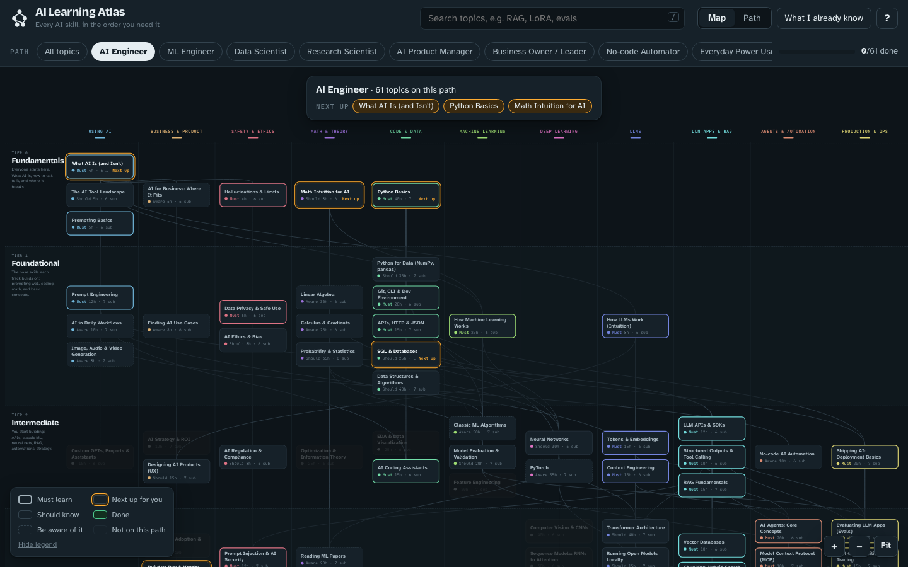
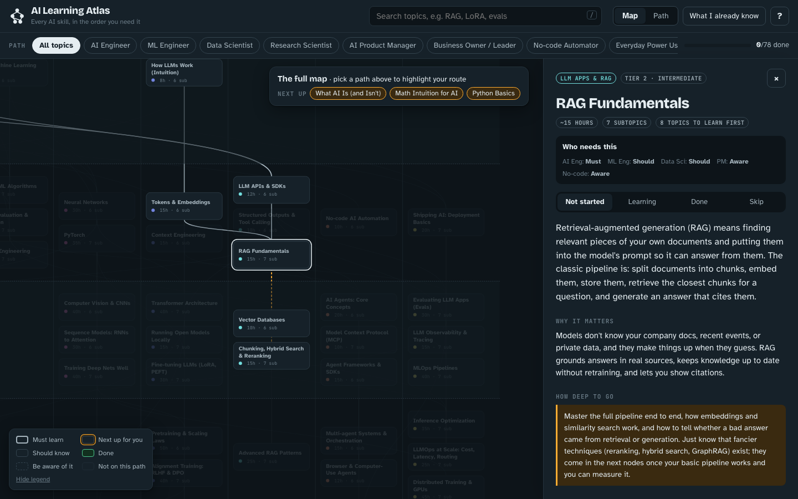

# AI Learning Atlas

**An interactive roadmap for learning AI. It shows what to learn, in what order, and how deep to go for your goal.**

🔗 **Live site: [airoadmap.daniellasek.com](https://airoadmap.daniellasek.com)**



Most "learn AI" lists are either a pile of links or a single path that assumes everyone wants to be a researcher.
The Atlas is a prerequisite map instead. Every topic shows what you need first, what it unlocks, and whether
*your* role needs to master it, should know it, or only needs to know it exists.

- **78 topics** across **6 tiers**: Fundamentals → Foundational → Intermediate → Advanced → Expert → Frontier
- **11 branches**: Using AI, Business & Product, Safety & Ethics, Math & Theory, Code & Data, Machine Learning,
  Deep Learning, LLMs, LLM Apps & RAG, Agents & Automation, Production & Ops
- **8 role paths** that share topics where the roles overlap
- **~1,100 curated resources** from official docs, well-known educators, courses, and the original papers
- No sign-up, no tracking, works on phones

## Pick a path

| Path | Topics | Must-learn | Est. hours* |
| --- | ---: | ---: | ---: |
| AI Engineer | 61 | 27 | ~810 |
| ML Engineer | 60 | 27 | ~1,260 |
| Research Scientist | 46 | 27 | ~1,230 |
| Data Scientist | 39 | 14 | ~680 |
| AI Product Manager | 35 | 14 | ~310 |
| No-code Automator | 27 | 10 | ~190 |
| Business Owner / Leader | 25 | 14 | ~190 |
| Everyday Power User | 17 | 8 | ~100 |

<sub>*Hours for the must-learn and should-know topics, starting from zero. Mark what you already know and the site recalculates.</sub>

## How it works



1. **Choose a path.** Topics your role doesn't need fade out. Bold borders mean *must learn*, plain borders *should know*,
   and dashed borders *be aware of it*.
2. **Tell it what you know.** Use "What I already know", or open a topic and press "I know this and everything before it".
   Orange rings then show what you can start next.
3. **Click any topic to go deeper.** You get:
   - what it is and why it matters
   - **how deep to go** (e.g. which algorithms to implement and which to only recognise)
   - what you'll be able to do afterwards
   - expandable subtopics tagged *core*, *deep*, or *optional*
   - resources with the best one marked "Start here"
   - a mini project to prove you've learned it

   The map lights up the full route to that topic.
4. **Switch to Path view** for the same content as an ordered checklist with a weekly time estimate.

Progress is stored in your browser only. You can copy it to another device from the help (?) menu.

## Run it locally

No dependencies beyond Python 3 for the build step.

```bash
git clone <this repo>
cd airoadmap
python3 scripts/build.py              # merges data/ into site/data.js
python3 -m http.server -d site 8000   # then open http://localhost:8000
```

Opening `site/index.html` directly in a browser also works.

## Project layout

```
data/
  structure.json      # the tree: topics, tiers, branches, prerequisites, role relevance
  content/*.json      # per-topic content: summary, depth, outcomes, subtopics, resources, project
  CONTENT_BRIEF.md    # writing and sourcing rules for content
site/                 # the static site (deploy this folder)
  index.html  styles.css  app.js  data.js (generated)
scripts/build.py      # validates data, writes site/data.js and a single-file bundle in dist/
```

Plain HTML, CSS, and JavaScript with no framework or bundler. Deploy the `site/` folder to any static host.

## Contributing

Found a broken link, a better resource, or a missing topic? Contributions are welcome. See [CONTRIBUTING.md](CONTRIBUTING.md).
Most changes only touch one JSON file.

## License

- Code (`site/`, `scripts/`): [MIT](LICENSE)
- Written content (`data/`): [CC BY 4.0](LICENSE-CONTENT). Reuse it with attribution.

Linked resources belong to their respective authors.
